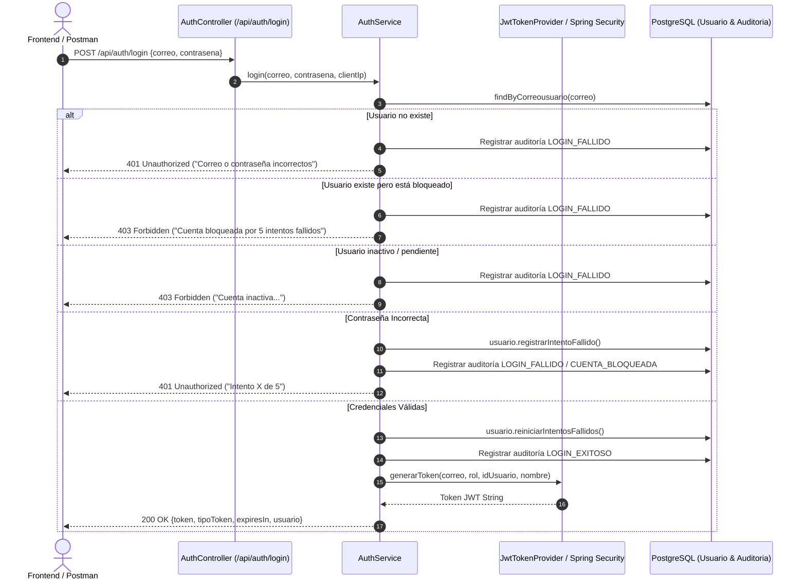

# Reporte de Arquitectura y Manual de Pruebas cURL — Módulo de Login Backend (SCIEM-PASS)

**Sistema:** Control de Ingreso a Exámenes Masivos (SCIEM-PASS / WindSoft)  
**Backend:** Java 21, Spring Boot 4.1.1, Spring Security, JWT (JJWT 0.12.5), Maven  
**URL Base en Desarrollo:** `http://localhost:8080`  

---

## 1. Resumen de lo Realizado

Se completó y verificó la arquitectura completa del backend de autenticación, seguridad y autorización basada en JWT para el sistema **SCIEM-PASS**, estructurado en el patrón Monolito Modular en 3 Capas (`presentacion`, `aplicacion`, `dominio`, `persistencia`, `infraestructura`):

1. **Configuración de Seguridad Stateless (`SecurityConfig.java`)**:
   - `SessionCreationPolicy.STATELESS` para evitar sesiones HTTP del servidor.
   - Manejadores customizados para errores de autenticación (`JwtAuthenticationEntryPoint` - HTTP 401) y acceso denegado (`JwtAccessDeniedHandler` - HTTP 403).
   - Rutas públicas permitidas: `/api/auth/**` y `/api/ping`.
   - Rutas de administración protegidas: `/api/admin/**` con el rol obligatorio `ADMINISTRADOR`.
   - Inyección del filtro `JwtAuthenticationFilter` antes de `UsernamePasswordAuthenticationFilter`.

2. **Proveedor de Tokens JWT (`JwtTokenProvider.java`)**:
   - Generación de tokens JWT firmados con clave secreta HMAC-SHA (`jwt.secret`).
   - Expiración predeterminada configurable (`jwt.expiration`, por defecto 30 minutos = 1,800,000 ms).
   - Claims incluidos en el payload: `sub` (correo), `rol` (ADMINISTRADOR, DOCENTE, OPERADOR, ESTUDIANTE), `idUsuario`, y `nombre`.

3. **Filtro de Autenticación per Request (`JwtAuthenticationFilter.java`)**:
   - Extracción de la cabecera `Authorization: Bearer <token>`.
   - Validación de firma y expiración del token JWT.
   - Normalización del rol asignando la autoridad Spring `ROLE_<ROL>` al `SecurityContextHolder`.

4. **Lógica de Negocio y Auditoría (`AuthService.java`)**:
   - Encriptación de contraseñas mediante BCrypt (`PasswordEncoder`).
   - **Prevención de Ataques de Fuerza Bruta**: Conteo de hasta 5 intentos fallidos consecutivos. Al quinto intento fallido, la cuenta se bloquea automáticamente.
   - **Control de Estado de Cuenta**: Las cuentas inactivas o en estado `PENDIENTE` (docentes/ayudantes registrados por `/api/auth/registro-personal`) son bloqueadas en el login devolviendo `403 Forbidden` hasta que un administrador las active.
   - **Auditoría Transversal (`AuditoriaService.java`)**: Registro automático en base de datos de eventos como `LOGIN_EXITOSO`, `LOGIN_FALLIDO`, `CUENTA_BLOQUEADA` y solicitudes de registro con IP de origen.

5. **Manejo Centralizado de Excepciones (`GlobalExceptionHandler.java`)**:
   - Respuestas HTTP estandarizadas en formato JSON unificado (`codigo`, `error`, `mensaje`, `detalles`, `timestamp`).

6. **Cobertura de Pruebas Unitarias**:
   - `JwtTokenProviderTest.java`: Validación de firma, expiración y parseo de claims.
   - `AuthServiceTest.java`: Pruebas de login exitoso, credenciales inválidas, incremento de contador de intentos fallidos, bloqueo tras 5 intentos y restricción por cuenta inactiva.

---

## 2. Diagrama del Flujo de Login y Seguridad



---

## 3. Colección de Comandos cURL para Pruebas en Postman / Terminal

Puedes copiar y pegar directamente estos comandos en tu terminal (Bash, PowerShell, zsh) o importarlos en Postman mediante `Import` -> `Raw text`.

### 3.1. Prueba de Ping de Salud del Servidor
```bash
curl -X GET "http://localhost:8080/api/ping"
```

---

### 3.2. Login Exitoso (Administrador)
```bash
curl -X POST "http://localhost:8080/api/auth/login" \
  -H "Content-Type: application/json" \
  -d '{
    "correo": "admin@umss.edu",
    "contrasena": "Password123*"
  }'
```
**Respuesta esperada (200 OK):**
```json
{
  "token": "eyJhbGciOiJIUzI1NiJ9...",
  "tipoToken": "Bearer",
  "expiresIn": 1800000,
  "usuario": {
    "idUsuario": 1,
    "ci": "1234567 CB",
    "nombre": "Juan",
    "apellido": "Perez",
    "telefono": 71234567,
    "correo": "admin@umss.edu",
    "estado": true,
    "rol": "ADMINISTRADOR",
    "intentosFallidos": 0,
    "permisos": ["GESTION_USUARIOS", "GESTION_ROLES", "VER_AUDITORIA", "CONTROL_INGRESO"]
  }
}
```

---

### 3.3. Login Fallido - Contraseña Incorrecta (Intento 1 a 4)
```bash
curl -X POST "http://localhost:8080/api/auth/login" \
  -H "Content-Type: application/json" \
  -d '{
    "correo": "admin@umss.edu",
    "contrasena": "ContrasenaErronea123"
  }'
```
**Respuesta esperada (401 Unauthorized):**
```json
{
  "codigo": 401,
  "error": "Unauthorized",
  "mensaje": "Contraseña incorrecta. Intento 1 de 5.",
  "timestamp": "2026-09-13T20:25:00"
}
```

---

### 3.4. Login Fallido - Bloqueo de Cuenta (Tras 5 Intentos)
```bash
curl -X POST "http://localhost:8080/api/auth/login" \
  -H "Content-Type: application/json" \
  -d '{
    "correo": "admin@umss.edu",
    "contrasena": "ContrasenaErronea123"
  }'
```
**Respuesta esperada (403 Forbidden):**
```json
{
  "codigo": 403,
  "error": "Forbidden",
  "mensaje": "Cuenta bloqueada temporalmente por 5 intentos fallidos consecutivos. Contacte al administrador.",
  "timestamp": "2026-09-13T20:25:05"
}
```

---

### 3.5. Auto-registro de Personal (Docente / Operador - Pendiente de Aprobación)
```bash
curl -X POST "http://localhost:8080/api/auth/registro-personal" \
  -H "Content-Type: application/json" \
  -d '{
    "nombre": "Carlos",
    "apellido": "Mamani Flores",
    "ci": "8765432 CB",
    "correo": "carlos.mamani@umss.edu",
    "contrasena": "MiPasswordSeguro123*",
    "telefono": 78945612,
    "rolSolicitado": "DOCENTE"
  }'
```
**Respuesta esperada (201 Created):**
```json
{
  "mensaje": "Solicitud registrada. Su cuenta quedará activa cuando el administrador la apruebe.",
  "idUsuario": 20,
  "correo": "carlos.mamani@umss.edu",
  "rol": "DOCENTE",
  "estado": "PENDIENTE"
}
```

---

### 3.6. Login de Cuenta Pendiente / Inactiva
```bash
curl -X POST "http://localhost:8080/api/auth/login" \
  -H "Content-Type: application/json" \
  -d '{
    "correo": "carlos.mamani@umss.edu",
    "contrasena": "MiPasswordSeguro123*"
  }'
```
**Respuesta esperada (403 Forbidden):**
```json
{
  "codigo": 403,
  "error": "Forbidden",
  "mensaje": "Cuenta inactiva. Si acaba de registrarse como Docente u Operador, debe esperar la aprobación del administrador.",
  "timestamp": "2026-09-13T20:25:10"
}
```

---

### 3.7. Auto-registro de Estudiante con Foto y Generación de QR (Multipart)
```bash
curl -X POST "http://localhost:8080/api/auth/registro-estudiante" \
  -F "file=@/ruta/a/tu/foto.jpg" \
  -F "nombre=Maria" \
  -F "apellido=Lopez Gomez" \
  -F "ci=8765432 CB" \
  -F "correo=202308123@est.umss.edu" \
  -F "contrasena=MiPasswordSeguro123*" \
  -F "codigoSis=202308123" \
  -F "telefono=71234567"
```
**Respuesta esperada (201 Created):**
```json
{
  "mensaje": "Estudiante registrado exitosamente",
  "idUsuario": 15,
  "idEstudiante": 8,
  "nombre": "Maria",
  "apellido": "Lopez Gomez",
  "ci": "8765432 CB",
  "correo": "202308123@est.umss.edu",
  "codigoSis": 202308123,
  "rol": "ESTUDIANTE",
  "fotoUrl": "https://res.cloudinary.com/...",
  "codigoQr": "data:image/png;base64,iVBORw0KGgoAAAANSUhEUgAA..."
}
```

---

### 3.8. Consultar Catálogo de Roles y Permisos (Requiere JWT Admin)
Reemplazar `<TU_TOKEN_JWT_AQUI>` con el token obtenido en el login del administrador.
```bash
curl -X GET "http://localhost:8080/api/admin/roles" \
  -H "Authorization: Bearer <TU_TOKEN_JWT_AQUI>"
```
**Respuesta esperada (200 OK):**
```json
[
  {
    "idRol": 1,
    "nombre": "ADMINISTRADOR",
    "descripcion": "Acceso total a la administración de usuarios, roles y auditoría",
    "permisos": ["GESTION_USUARIOS", "GESTION_ROLES", "VER_AUDITORIA", "CONTROL_INGRESO"]
  },
  {
    "idRol": 2,
    "nombre": "DOCENTE",
    "descripcion": "Gestión de exámenes y visualización de habilitaciones",
    "permisos": ["GESTION_EXAMENES", "VER_PERFIL_PROPIO"]
  },
  {
    "idRol": 3,
    "nombre": "OPERADOR",
    "descripcion": "Personal de control de ingreso en accesos y escaneo de QR",
    "permisos": ["CONTROL_INGRESO", "VER_PERFIL_PROPIO"]
  },
  {
    "idRol": 4,
    "nombre": "ESTUDIANTE",
    "descripcion": "Visualización de su código QR y estado de habilitación",
    "permisos": ["VER_PERFIL_PROPIO"]
  }
]
```

---

### 3.9. Activar / Aprobar Cuenta Pendiente (PATCH /api/admin/usuarios/{id}/estado)
```bash
curl -X PATCH "http://localhost:8080/api/admin/usuarios/20/estado" \
  -H "Authorization: Bearer <TU_TOKEN_JWT_AQUI>" \
  -H "Content-Type: application/json" \
  -d '{
    "nuevoEstado": "ACTIVO"
  }'
```
**Respuesta esperada (200 OK):**
```json
{
  "mensaje": "Estado de usuario actualizado exitosamente",
  "idUsuario": 20,
  "estado": "ACTIVO"
}
```

---

### 3.10. Consultar Historial de Auditoría
```bash
curl -X GET "http://localhost:8080/api/admin/auditoria" \
  -H "Authorization: Bearer <TU_TOKEN_JWT_AQUI>"
```
**Respuesta esperada (200 OK):**
```json
[
  {
    "idAuditoria": 105,
    "tipoOperacion": "LOGIN_EXITOSO",
    "usuarioEjecutor": "admin@umss.edu",
    "usuarioAfectado": "admin@umss.edu",
    "detalles": "Inicio de sesión exitoso.",
    "ipOrigen": "127.0.0.1",
    "fechaHora": "2026-09-13T20:21:00"
  }
]
```

---

## 4. Instrucciones para Ejecución Local

Para levantar el backend localmente y ejecutar las pruebas:

```bash
# 1. Posicionarse en la carpeta del backend
cd control-ingreso-backend

# 2. Correr el backend con el perfil local
./mvnw.cmd spring-boot:run "-Dspring-boot.run.profiles=local"

# 3. Ejecutar las pruebas unitarias
./mvnw.cmd test
```
