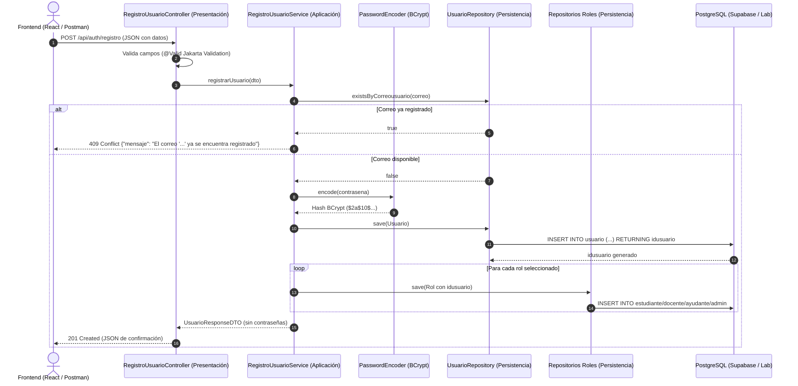

# Manual de Funcionamiento y Pruebas — API de Registro de Usuarios

## Módulo: Autenticación y Registro de Usuarios (SCIEM-PASS / WindSoft)

Este documento detalla el funcionamiento del backend implementado para la pantalla de **Registro de Usuarios** (`RegistroPage.jsx`), su arquitectura en 3 capas, el mapeo con la base de datos PostgreSQL, y una guía completa con comandos `cURL` listos para probar en **Postman** o la terminal.

---

## 1. Visión General del Funcionamiento

El módulo de registro permite dar de alta nuevos usuarios en el sistema SCIEM-PASS asignándoles uno o más roles (`estudiante`, `docente`, `ayudante`, `admin`).

### Flujo de Ejecución de Extremo a Extremo:


---

## 2. Arquitectura del Backend por Capas

El backend respeta estrictamente el patrón monolito modular en capas establecido para el proyecto:

### 1. `presentacion/` (Controladores y DTOs)
- **`RegistroUsuarioController.java`**: Expone el endpoint `POST /api/auth/registro`. Recibe la petición HTTP, invoca las validaciones de anotaciones `@Valid` y delega la ejecución al servicio. No contiene lógica de negocio ni sentencias SQL.
- **`RegistroUsuarioRequestDTO.java`**: Define y valida la estructura de datos entrante (nombres, apellidos, teléfono, correo, contraseña, CI, código SIS, lista de roles).
- **`UsuarioResponseDTO.java`**: Devuelve al cliente únicamente la información pública del usuario creado (id, nombres, apellidos, correo, teléfono, roles, estado) asegurando que la contraseña nunca sea expuesta.

### 2. `aplicacion/` (Servicios de Negocio)
- **`RegistroUsuarioService.java`**: Coordina el caso de uso completo bajo una transacción `@Transactional`:
  1. Comprueba si el correo electrónico ya existe en la base de datos (lanza `RecursoDuplicadoException` -> `409 Conflict`).
  2. Valida que se haya seleccionado al menos un rol válido (`estudiante`, `docente`, `ayudante`, `admin`).
  3. Concatena y normaliza nombres (`primerNombre` + `segundoNombre`) y apellidos (`apellidoPaterno` + `apellidoMaterno`).
  4. Encripta la contraseña usando **BCrypt** antes de almacenarla.
  5. Guarda el registro en la tabla `usuario`.
  6. Inserta automáticamente las filas en las tablas de roles correspondientes (`estudiante`, `docente`, `ayudante`, `admin`) con el `idusuario` generado.

### 3. `dominio/` (Entidades JPA)
- **`Usuario.java`**: Mapeada a la tabla `public.usuario`.
- **`Estudiante.java`**: Mapeada a la tabla `public.estudiante` (`codsisestudiante` PK/FK).
- **`Docente.java`**: Mapeada a la tabla `public.docente` (`codsisdocente` PK/FK).
- **`Ayudante.java`**: Mapeada a la tabla `public.ayudante` (`idayudante` PK/FK).
- **`Admin.java`**: Mapeada a la tabla `public.admin` (`idadmin` PK/FK).
- **`MotivoInhabilitacion.java` y `Habilitacion.java`**: Mapeadas a sus tablas correspondientes.

### 4. `persistencia/` (Repositorios Spring Data JPA)
- **`UsuarioRepository.java`**: Consultas como `existsByCorreousuario(...)`, `findByCorreousuario(...)`, etc.
- **`EstudianteRepository.java`**, **`DocenteRepository.java`**, **`AyudanteRepository.java`**, **`AdminRepository.java`**: Repositorios para persistir los roles.

### 5. `infraestructura/` (Seguridad y Manejo de Excepciones)
- **`SecurityConfig.java`**: Configura el bean `PasswordEncoder` (`BCryptPasswordEncoder`) y permite el acceso público a las rutas `/api/auth/**`.
- **`GlobalExceptionHandler.java`**: Intercepta excepciones en toda la aplicación y genera respuestas JSON limpias y homogéneas con el formato `{ "mensaje": "..." }`.

---

## 3. Contrato de API: `POST /api/auth/registro`

- **URL:** `http://localhost:8080/api/auth/registro`
- **Método:** `POST`
- **Headers:** `Content-Type: application/json`

### Cuerpo de la Petición (Request Body):
```json
{
  "primerNombre": "Carlos",
  "segundoNombre": "Eduardo",
  "apellidoPaterno": "Mamani",
  "apellidoMaterno": "Flores",
  "telefono": "76543210",
  "correo": "carlos.mamani@umss.edu",
  "contrasena": "PasswordSeguro123",
  "carnetIdentidad": "8765432 CB",
  "codigoSis": "202104567",
  "roles": [
    "estudiante"
  ]
}
```

### Respuestas Posibles:

#### A. Éxito (`201 Created`):
```json
{
  "idUsuario": 1,
  "ciUsuario": "8765432 CB",
  "nombreUsuario": "Carlos Eduardo",
  "apellidoUsuario": "Mamani Flores",
  "nombreCompleto": "Carlos Eduardo Mamani Flores",
  "correoUsuario": "carlos.mamani@umss.edu",
  "telefonoUsuario": 76543210,
  "roles": [
    "estudiante"
  ],
  "estadoUsuario": true,
  "mensaje": "Usuario registrado exitosamente en el sistema."
}
```

#### B. Error por Correo Duplicado (`409 Conflict`):
```json
{
  "mensaje": "El correo 'carlos.mamani@umss.edu' ya se encuentra registrado en el sistema."
}
```

#### C. Error de Validación de Campos (`400 Bad Request`):
```json
{
  "mensaje": "La contraseña debe tener al menos 8 caracteres"
}
```

---

## 4. Comandos cURL para Pruebas

Puedes ejecutar estos comandos directamente en tu terminal (Git Bash, CMD o PowerShell) o importarlos en Postman.

### Prueba 1: Registro Exitoso de un Estudiante
```bash
curl -X POST http://localhost:8080/api/auth/registro \
  -H "Content-Type: application/json" \
  -d '{
    "primerNombre": "Juan",
    "segundoNombre": "Carlos",
    "apellidoPaterno": "Perez",
    "apellidoMaterno": "Gomez",
    "telefono": "71234567",
    "correo": "juan.perez@umss.edu",
    "contrasena": "ClaveSegura2026",
    "carnetIdentidad": "12345678",
    "codigoSis": "202001234",
    "roles": ["estudiante"]
  }'
```

### Prueba 2: Registro Exitoso de un Docente y Ayudante (Múltiples Roles)
```bash
curl -X POST http://localhost:8080/api/auth/registro \
  -H "Content-Type: application/json" \
  -d '{
    "primerNombre": "Maria",
    "segundoNombre": "",
    "apellidoPaterno": "Rojas",
    "apellidoMaterno": "Suarez",
    "telefono": "79876543",
    "correo": "maria.rojas@umss.edu",
    "contrasena": "DocentePass2026",
    "carnetIdentidad": "98765432",
    "codigoSis": "201905678",
    "roles": ["docente", "ayudante"]
  }'
```

### Prueba 3: Intentar registrar el mismo correo de nuevo (Verificar 409 Conflict)
```bash
curl -X POST http://localhost:8080/api/auth/registro \
  -H "Content-Type: application/json" \
  -d '{
    "primerNombre": "Juan",
    "segundoNombre": "Carlos",
    "apellidoPaterno": "Perez",
    "apellidoMaterno": "Gomez",
    "telefono": "71234567",
    "correo": "juan.perez@umss.edu",
    "contrasena": "ClaveSegura2026",
    "carnetIdentidad": "12345678",
    "codigoSis": "202001234",
    "roles": ["estudiante"]
  }'
```

### Prueba 4: Validación de Contraseña Corta (Verificar 400 Bad Request)
```bash
curl -X POST http://localhost:8080/api/auth/registro \
  -H "Content-Type: application/json" \
  -d '{
    "primerNombre": "Ana",
    "apellidoPaterno": "Torres",
    "correo": "ana.torres@umss.edu",
    "contrasena": "123",
    "carnetIdentidad": "55566677",
    "roles": ["estudiante"]
  }'
```

### Prueba 5: Validación sin Roles (Verificar 400 Bad Request)
```bash
curl -X POST http://localhost:8080/api/auth/registro \
  -H "Content-Type: application/json" \
  -d '{
    "primerNombre": "Pedro",
    "apellidoPaterno": "Alvarez",
    "correo": "pedro.alvarez@umss.edu",
    "contrasena": "PasswordLargo123",
    "carnetIdentidad": "44433322",
    "roles": []
  }'
```

---

## 5. Guía Paso a Paso para Probar en Postman

### Opción A: Importar directamente con cURL (Método más rápido)
1. Abre **Postman**.
2. Haz clic en el botón superior **Import** (o `Ctrl + O`).
3. Pega cualquiera de los comandos `curl` anteriores en el cuadro de texto.
4. Postman creará automáticamente la petición con el método `POST`, la URL, los headers y el body JSON listos.
5. Haz clic en **Send**.

### Opción B: Crear la Petición Manualmente
1. Haz clic en **New** -> **HTTP Request**.
2. Cambia el método de `GET` a **`POST`**.
3. En la barra de dirección coloca: `http://localhost:8080/api/auth/registro`.
4. Ve a la pestaña **Headers** y añade:
   - **Key:** `Content-Type`
   - **Value:** `application/json`
5. Ve a la pestaña **Body**:
   - Selecciona la opción **raw**.
   - En el menú desplegable del formato (a la derecha), selecciona **JSON**.
   - Pega el JSON del body (como en la Prueba 1).
6. Presiona el botón azul **Send**.
7. Verifica en la parte inferior:
   - **Status:** `201 Created`
   - **Body:** El objeto JSON con los datos del usuario registrado.

---

## 6. Cómo Ejecutar el Backend y Frontend Localmente

### 1. Iniciar el Backend (Spring Boot)
Abre una terminal en la raíz del backend (`control-ingreso-backend/`) y ejecuta:
```bash
./mvnw.cmd spring-boot:run "-Dspring-boot.run.profiles=local"
```
*(El backend quedará escuchando en `http://localhost:8080`)*.

### 2. Iniciar el Frontend (React + Vite)
Abre otra terminal en la raíz del frontend (`control-ingreso-frontend/`) y ejecuta:
```bash
npm run dev
```
*(Abre en tu navegador `http://localhost:5173` para interactuar con la pantalla de registro visualmente)*.
